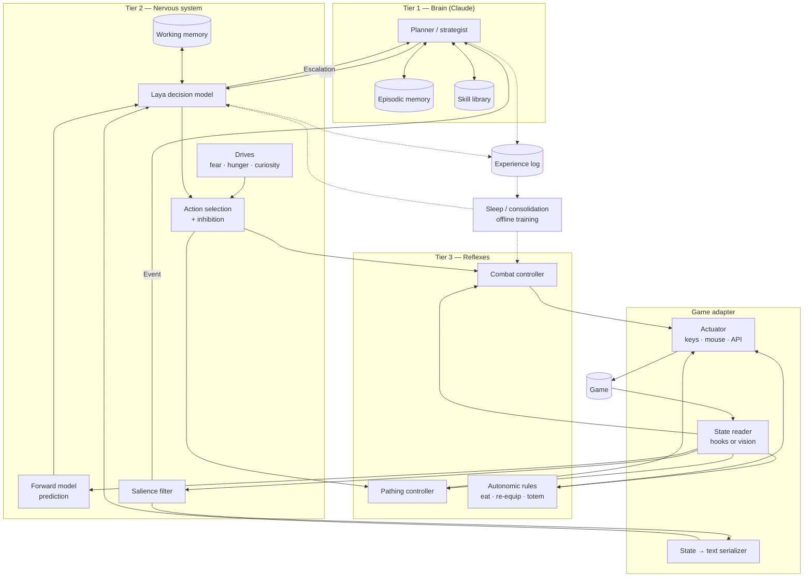

# Game Nervous System — Architecture

> An AI that plays real-time games by splitting thinking from reacting.
> **Claude** is the brain. **Laya** is the nervous system. **Reflex controllers** are the spinal cord.

Status: design document, v0.1 (7 Nov 2026). Nothing here is built yet except the scaffold in this repo.

---

## Table of contents

1. [Why this exists](#1-why-this-exists)
2. [The core idea: three tiers](#2-the-core-idea-three-tiers)
3. [System map](#3-system-map)
4. [Tier 1 — The brain (Claude)](#4-tier-1--the-brain-claude)
5. [Tier 2 — The nervous system (Laya)](#5-tier-2--the-nervous-system-laya)
6. [Tier 3 — Reflexes](#6-tier-3--reflexes)
7. [Supporting modules](#7-supporting-modules)
8. [Game adapters](#8-game-adapters)
9. [Shared action vocabulary](#9-shared-action-vocabulary)
10. [Message protocol](#10-message-protocol)
11. [Timing, staleness and overrides](#11-timing-staleness-and-overrides)
12. [The learning loop](#12-the-learning-loop)
13. [Going multi-game](#13-going-multi-game)
14. [Rules, safety and licensing](#14-rules-safety-and-licensing)
15. [Risks and open questions](#15-risks-and-open-questions)
16. [Glossary](#16-glossary)

---

## 1. Why this exists

Large language models are good at planning and bad at reacting. A Claude call takes on the order of seconds; a Minecraft tick is 50 ms; a 60 fps shooter frame is about 16 ms. Asking an LLM to press keys directly means it is always reacting to a world that no longer exists.

Every serious real-time game AI already works around this by using a **small, fast policy** for moment-to-moment control. Minecraft Combat AI (see `REFERENCES.md`) runs its combat models in about 1.8 ms per tick locally and beats ranked players — but nothing in it decides *when* to fight, retreat, or change plans. LLM agents (Voyager, Gemini on Mineflayer) do the opposite: they plan well and can't fight.

This project joins the two, the way a body does:

- a **brain** that thinks slowly and sets intent,
- a **nervous system** that makes fast decisions inside that intent and reports surprises upward,
- **reflexes** that execute without any thought at all,
- and a **learning loop** in which the brain gradually teaches the nervous system, so the whole thing gets faster the more it plays.

The design is game-agnostic. Minecraft is the first testbed because the existing bot army (Baritone/AltoClef + LLM commander) is already a primitive version of tiers 1 and 3.

---

## 2. The core idea: three tiers

| Tier | Component | Runs | Cadence | Decides | Output |
|---|---|---|---|---|---|
| 1 | **Brain** — Claude (or any LLM) | Cloud API | Every 1–5 s, or on escalation | Strategy, goals, priorities, constraints | `Goal` objects |
| 2 | **Nervous system** — Laya | Local GPU | Every 50–100 ms (10–20 Hz) | Tactical choices inside the current goal | `Decision` (choice + probability + confidence) |
| 3 | **Reflexes** — learned or scripted controllers | Local, in-game | Every tick / frame | Exact inputs | Keys, mouse/camera deltas, API calls |

Design rules that follow from this split:

1. **Each tier only talks to its neighbours.** Claude never presses keys; reflexes never choose strategy.
2. **Each tier must be competent on its own for its time window.** Laya must keep the bot alive for several seconds with a stale goal. Reflexes must finish an action without waiting on Laya.
3. **Information flows down as intent, up as surprise.** Goals go down; escalations, events and outcomes come up.
4. **Every correction becomes training data.** When a higher tier overrides a lower one, that moment is logged and later used to train the lower tier.

### Why Laya for tier 2

Laya is an open-source (Apache 2.0) local decision model, built as a free stand-in for TypeSafe AI's hosted **Jev** "System One" model. Both take a block of context plus a set of options you define and return a typed choice with a probability. That output shape is exactly what the middle tier needs:

- **Typed options** keep it fast and trainable — it picks, it never writes.
- **A probability per choice** gives the escalation logic for free: low confidence → ask the brain.
- **Local inference** (~33–40 ms per decision on a Tesla T4, per published benchmarks) beats Jev's hosted API latency (roughly 70–500 ms, company-reported) and costs nothing per call.

Jev itself remains an option for non-time-critical decisions or as a comparison baseline. See §5.

---

## 3. System map



---

## 4. Tier 1 — The brain (Claude)

### Responsibilities

- Turn a high-level mission ("get full diamond", "win this 1v1", "defend the base") into a **goal stack**.
- Set **constraints and priorities** on each goal (e.g. "survival over loot", "don't leave the river").
- Answer **escalations** from Laya.
- Review logs during **sleep** and label mistakes, write new skills, and propose new options for Laya's vocabulary.
- Coordinate multiple bots (hive mode, §7.10).

### Inputs: the world summary

The brain never sees raw frames. It receives a compact **world summary** built by the adapter and salience filter:

```
[t=812.4s] mission: get full diamond armour
status: health 14/20, hunger 16/20, armour iron x4, pickaxe iron (40% durability)
position: y=-54, in branch mine, 120 blocks from base
recent events: (t-6s) found 3 diamond ore; (t-2s) zombie spawned 8 blocks behind
active goal: mine diamonds in this vein (expires t+30s)
laya: last 5 decisions confident (mean 0.91); no escalations
drives: fear 0.2, hunger 0.3, curiosity 0.5
```

Target size: under ~600 tokens per update, so updates are cheap and fast.

### Outputs: goals

The brain outputs `Goal` objects (full schema in §10 and `protocol/goal.schema.json`):

- `intent` — one of the shared vocabulary verbs (§9) plus a target.
- `constraints` — conditions that must hold ("stay within 20 blocks of base").
- `priorities` — ordered list ("survive > protect inventory > finish task").
- `valid_while` — conditions under which the goal is still valid.
- `expires_at` — hard deadline after which Laya treats the goal as stale.
- `on_fail` — what Laya should do if the goal becomes impossible before the brain answers.

### Cadence and wake conditions

The brain is **event-driven, not polled**. It runs when:

1. The current goal completes, fails, or expires.
2. Laya escalates (low confidence, impossible goal, conflicting drives).
3. The salience filter raises a high-priority event (new player, large damage spike, unexpected death).
4. A heartbeat timer fires (e.g. every 10 s) as a safety net.

This keeps API cost proportional to how *surprising* the game is, not to how long it runs.

### Model choice

Claude by default; the brain interface is model-agnostic so a local LLM or the free Gemini API (already used by the bot army) can be swapped in. A cheaper/faster model can handle routine re-planning, with a stronger model reserved for sleep-time review.

---

## 5. Tier 2 — The nervous system (Laya)

### What Laya is

| Variant | Params | Base | Context | Use here |
|---|---|---|---|---|
| Laya English | 421M | ModernBERT-large | 512 tokens (default) | Default for English state text |
| Laya Multilingual | 322M | mmBERT-base | 1,024 (up to 8,192) | If longer state text is needed |
| Laya Typed Decisions | 421M | ModernBERT-large | 512 | **Starting checkpoint** — tuned for typed choices |

Licence: Apache 2.0 (fine-tuning and redistribution allowed). Published on Hugging Face (`convaiinnovations`), code on GitHub (`NandhaKishorM`). Figures from third-party benchmark write-ups — re-measure on our own hardware.

### Input: state as text

Laya is a text encoder, so the adapter's serializer turns state into a short, **fixed-order, fixed-format** description. Consistency matters more than prose quality — the model learns the format.

```
GOAL engage player:Steve | CONSTRAINT stay_near base | PRIORITY survive>win
SELF hp 12/20 hunger 18 armor diamond totem offhand yes cooldown ready
OPP dist 3.1 hp ~8/20 weapon sword facing_me yes crit_threat high
ENV ground flat lava_near no allies 0 enemies 1
PRED opp_aim_lock 0.94 sprint_crit_incoming 0.81
DRIVES fear 0.4 hunger 0.1
WM last_actions engage,engage,engage last_outcome traded_hits
```

Rules for the serializer:

- Keep it under ~350 tokens to leave room for the option list and stay inside 512.
- Quantise continuous values (distance to 0.1, health as integer) so tiny changes don't look like new situations.
- Always include the forward-model predictions (`PRED`) — they are the most useful single features.
- Same field order every time; missing fields written as `none`, never omitted.

### Options: small and per-context

Laya's accuracy drops as the option set grows, so the adapter offers **only the options valid in the current context**, usually 3–8:

- In combat: `engage`, `disengage`, `heal`, `use_ability:totem_swap`, `reposition`, `escalate`
- While gathering: `continue`, `return_to_base`, `flee`, `eat`, `escalate`

`escalate` is always available as an explicit option, in addition to confidence-based escalation.

### Output and escalation

Each decision returns the chosen option, its probability, and the full distribution. Laya **acts** when:

```
p(top) >= act_threshold          (default 0.75, per-game tunable)
and margin(top, second) >= 0.15
and top != "escalate"
```

Otherwise it **escalates** to the brain *and* takes the configured safe default (usually the goal's `on_fail`, or `disengage` in combat) while waiting.

### Calibration is mandatory

Laya's raw probabilities can be overconfident. Since escalation depends on them, every fine-tuned checkpoint gets a **calibration pass** (temperature scaling on a held-out set of logged decisions) before deployment. Track ECE and Brier score per game in the benchmark harness (§12.5).

### Fine-tuning is mandatory

The base model is weak zero-shot on typed decisions (reported below a majority-class baseline); the specialised checkpoint is what beats Jev. Plan for Laya to be **useless until fine-tuned on our own logged decisions** — the brain does the labelling at first (§12).

### Throughput

~33–40 ms for one decision on a T4; batching raises throughput to hundreds of decisions per second. Two consequences:

- One GPU can serve **many bots** in the army by batching their decisions each 50–100 ms cycle.
- 10–20 Hz decisions are the ceiling — anything faster belongs in tier 3.

### Where Jev fits

Jev (hosted, `jev-latest`, via TypeSafe API / OpenRouter / Vercel AI Gateway) is useful as:

- a **comparison baseline** in benchmarks,
- a **labeller** for early training data, *if* TypeSafe's terms allow training on its output (check before using),
- a decision model for **non-real-time** choices where 200+ ms is fine.

---

## 6. Tier 3 — Reflexes

### Contract

Every reflex controller implements the same interface regardless of how it works inside:

```
start(goal_params) -> handle
tick(state) -> inputs            # called every game tick/frame
status() -> running | succeeded | failed | stuck
cancel()                          # must stop within one tick (inhibition)
```

Laya picks *which* reflex runs and with what parameters; the reflex decides *how*.

### Kinds

- **Learned controllers** — small neural policies trained on recorded play plus self-play. Example and reference design: Minecraft Combat AI (GRU/transformer, ~78–1,495 numeric inputs per tick, movement/jump/sprint/attack heads plus discretised aim heads).
- **Scripted controllers** — Baritone pathing, AltoClef tasks, aim smoothing, combo strings.
- **Autonomic rules** — no model at all: eat when hunger < N, re-equip broken tools, swap a totem into the offhand. Never escalated.

### Reference design: Minecraft Combat AI

Lessons to copy:

| Their choice | Why it matters to us |
|---|---|
| One observation → one action every 50 ms tick | Confirms the reflex budget is easy to hit (1.8 ms local) |
| Auxiliary prediction heads (opponent aim lock, sprint-crit incoming, space safe) | These *are* our forward model; feed them up to Laya as `PRED` |
| Switch from fixed-window transformers to GRUs | Recurrent memory is cheaper for long fights → working memory in tier 3 |
| Behaviour cloning → self-play RL → league training | The training recipe for every learned reflex (§12.4) |
| Server-side checks that the camera follows the model's turns | Reflex outputs must be applied exactly; log any divergence |

What we can and can't use from them is in §14.

---

## 7. Supporting modules

Each maps to a part of a biological nervous system. Build order is in `ROADMAP.md`.

### 7.1 Forward model (cerebellum)

Predicts the next 100–500 ms of state: opponent position, incoming damage, whether a jump will land. Two jobs:

1. **Latency compensation** — Laya decides on the *predicted* state, not the stale one.
2. **Surprise detection** — when reality diverges from the prediction beyond a threshold, emit a `Surprise` event; large surprises wake the brain.

Start with the auxiliary heads of the combat reflex (free predictions) and simple physics extrapolation; train a dedicated model later.

### 7.2 Salience filter (thalamus)

Decides what is worth noticing. Scores every state change (new entity, damage, item pickup, sound, goal progress) and passes only high-salience changes to the brain as `Event`s. Rule-based first, learned later from which events the brain actually acted on.

### 7.3 Memory

| Kind | Holds | Lives in | Used by |
|---|---|---|---|
| Working | Last ~5–10 s of events and actions | Ring buffer in tier 2 | Laya (`WM` line), reflex GRU state |
| Episodic | Full log of episodes: what happened, outcome | Local DB (SQLite / vector index) | Brain (retrieval), sleep |
| Skill | Named behaviours: parameters, preconditions, success rate | Skill registry | Brain (planning), Laya (option set) |

### 7.4 Drives (limbic system)

Scalars in [0, 1] computed from state each tick: `fear` (health, threats, outnumbered), `hunger`, `fatigue` (tool durability, time on task), `curiosity` (unexplored area, idle time). They:

- bias Laya's option scores (added as the `DRIVES` line and as a post-hoc prior),
- give the brain a one-line mood summary,
- produce believable behaviour cheaply.

### 7.5 Pain and reward

Every log entry carries outcome signals: damage taken/dealt, deaths, goal completion, time wasted, resources gained. Per-game reward weights live in the game config. This is what fine-tuning and RL optimise.

### 7.6 Action selection and inhibition (basal ganglia)

When drives or decisions conflict, one action wins and the rest are suppressed. Also provides the **veto**: any tier can cancel a running reflex within one tick when something urgent happens (e.g. abort a mining action when `fear` spikes).

### 7.7 Proprioception

An authoritative self-state record: position, velocity, inventory, cooldowns, current reflex and its status. Bots fail surprisingly often by losing track of themselves; this is the single source of truth all tiers read.

### 7.8 Autonomic background tasks

Pure rules for things that should never need thought (§6). Configured per game.

### 7.9 Sleep (offline consolidation)

Runs between sessions:

1. Brain reviews episode logs and labels mistakes and good decisions.
2. Corrections are turned into Laya training examples (§12.2).
3. New skills are written to the skill library.
4. Laya is fine-tuned and **re-calibrated**; reflexes optionally retrained.
5. Benchmark harness runs; the new checkpoint is promoted only if it doesn't regress.

### 7.10 Hive communication

For multiple bots: a shared message bus (local pub/sub) carrying danger warnings, resource locations, task claims, and "pheromone" markers in world coordinates. The brain acts as the coordinator above all bots; Laya instances batch on one GPU.

### 7.11 Kill switch

A hard stop independent of every other component: releases all inputs, cancels all reflexes, disconnects the adapter. Triggered by hotkey, by the rules layer (§14), or by a watchdog if any tier stops responding.

---

## 8. Game adapters

Everything game-specific lives in one adapter per game. Nothing above the adapter knows which game is running.

### Interface

```
class GameAdapter:
    profile: LatencyProfile            # which tiers run and how fast
    rules: PlayRules                   # where the bot may connect

    read_state() -> RawState           # hooks, mod, memory, or vision
    describe(state, goal) -> str       # serializer for Laya (§5)
    summarise(state) -> str            # world summary for the brain (§4)
    options(state, goal) -> list[str]  # context-valid Laya options (§9)
    reflexes() -> dict[str, Reflex]    # available tier-3 controllers
    act(inputs) -> None                # keys, mouse, controller, API
    reward(prev, state) -> Reward      # per-game reward signals (§7.5)
```

### Reading state: two paths

1. **Hooks (preferred)** — a mod, plugin, protocol client or API that exposes exact state. Precise and cheap. Minecraft: Fabric mod or Mineflayer.
2. **Vision (fallback)** — for games that can't be modded: a small, fast detector (YOLO-style) every frame for entities, items and HUD numbers, plus an occasional screenshot to the brain for the big picture. Slower and noisier; expect lower performance.

### Latency profiles

| Profile | Example games | Tiers active |
|---|---|---|
| `turn_based` | Chess, card games, turn-based strategy | Brain only |
| `realtime_strategic` | Minecraft survival, Factorio, colony sims | Brain + Laya + scripted reflexes |
| `realtime_twitch` | PvP, shooters, fighting games | All three; learned reflexes do most of the work |

The runtime chooses which tiers to start from the adapter's profile.

---

## 9. Shared action vocabulary

Laya's options use generic verbs that mean the same thing in every game. Adapters map them to game specifics. This keeps option sets small and lets Laya learn instincts that transfer between games.

| Verb | Meaning | Minecraft mapping (example) |
|---|---|---|
| `engage` | Fight the current target | Run combat reflex vs target |
| `disengage` | Break contact and create distance | Sprint away, pearl, pillar up |
| `heal` | Restore health | Eat golden apple, drink potion |
| `reposition` | Move to a better spot without disengaging | Strafe to high ground |
| `use_ability:<name>` | Use a named game ability | `totem_swap`, `place_crystal` |
| `gather:<resource>` | Collect a resource | Baritone mine task |
| `explore` | Seek unexplored area | Random-walk / frontier exploration |
| `return:<place>` | Go to a named place | Path to base |
| `regroup` | Move toward allies | Path to nearest bot |
| `build:<blueprint>` | Construct something | Schematic task |
| `wait` | Hold position, observe | Idle with head tracking |
| `escalate` | Ask the brain | Send `Escalation` |

New verbs are added only when an existing one can't express a recurring situation — the brain proposes them during sleep.

---

## 10. Message protocol

All messages are JSON over a local bus (in-process queue first; ZeroMQ/NATS later for multi-process/multi-bot). Schemas live in `protocol/`.

| Message | From → To | Purpose |
|---|---|---|
| `Goal` | Brain → Laya | Set intent, constraints, priorities, expiry |
| `Decision` | Laya → reflex layer & log | Chosen option, distribution, confidence |
| `Escalation` | Laya → Brain | Low confidence / impossible goal / conflict |
| `Event` | Salience → Brain | High-salience state change |
| `Surprise` | Forward model → Laya / Brain | Prediction error above threshold |
| `Correction` | Brain → log | Brain overrode or relabelled a Laya decision |
| `Outcome` | Adapter → log | Reward signals for a decision window |
| `Kill` | Anyone → runtime | Stop everything |

Every message carries `bot_id`, `game`, `t` (game time), `wall_t`, and `episode_id` so the experience log can be joined later.

---

## 11. Timing, staleness and overrides

The brain's view is always 1–5 s old. The design handles this explicitly:

1. **Goals expire.** `expires_at` is mandatory. After it, Laya treats the goal as stale and follows `on_fail` until a new goal arrives.
2. **Goals are conditional.** `valid_while` lists conditions ("no enemy within 5 blocks"). When one breaks, the goal is suspended immediately — no waiting for the brain.
3. **Lower tiers may override upward intent for survival.** Laya can disengage during an `engage` goal if `fear` and prediction say death is likely; reflexes can abort an action that would kill the bot (lava, void). Overrides are logged as events.
4. **Replies older than the current state are discarded.** If the brain answers an escalation about a situation that has since resolved, the answer is ignored (logged, not applied).
5. **Watchdogs.** If Laya doesn't decide within 2× its cadence, the reflex layer holds the last safe action; if the brain doesn't answer within its timeout, Laya keeps acting on `on_fail`.

---

## 12. The learning loop

The system improves by having slow tiers teach fast tiers.

### 12.1 Experience log

Every Laya decision is logged with: serialized state text, offered options, chosen option, full distribution, active goal, brain correction (if any), and outcome signals over the following window. Format: append-only JSONL per episode, indexed into SQLite.

### 12.2 Distillation (brain → Laya)

DAgger-style:

1. Laya acts; the brain samples a fraction of decisions (plus every escalation) and says what it would have chosen.
2. Disagreements and escalations become labelled examples: `(state text, options) → brain's choice`.
3. Fine-tune Laya on the accumulated set; re-calibrate; benchmark.
4. Repeat. Over time the escalation rate should fall — **escalation rate per hour is the headline metric** of the whole project.

Bootstrapping: before Laya is useful, run the brain on *every* decision at a slow game speed (or in turn-based replays of recorded play) to build the first dataset.

### 12.3 Calibration

Temperature scaling on a held-out slice of recent logged decisions, per game. Gate deployment on ECE and Brier score not regressing.

### 12.4 Reflex training recipe

For learned reflexes, follow the Minecraft Combat AI recipe:

1. **Behaviour cloning** on recorded human play (record yourself first).
2. **Self-play RL** so the policy improves past the humans it copied.
3. **League training** against exploiter policies whose only job is to find weaknesses.

Requires fast, parallel game instances (§13).

### 12.5 Benchmark harness

A fixed scenario suite per game, run after every retrain:

- Minecraft examples: survive 5 min in a mob-dense area; win a 1v1 vs a fixed bot; gather 64 logs; mine to diamonds from a fixed seed.
- Metrics: success rate, time to complete, deaths, escalations per hour, Laya ECE/Brier, brain tokens per hour.
- A checkpoint is promoted only if no core metric regresses beyond tolerance.

---

## 13. Going multi-game

To make the same system play many games:

1. **Adapters** isolate everything game-specific (§8).
2. **The shared vocabulary** (§9) lets Laya learn transferable instincts ("disengage when outnumbered and low").
3. **Cross-game memory**: episodic entries and skills are tagged by game *and* situation type, so lessons can be retrieved across games.
4. **One data pipeline**: all games log in the same format; Laya is fine-tuned on the union, with a `GAME` line in the state text so it can still specialise.
5. **Per-game reflex libraries**: the bottom tier is where games differ most; it stays per game.
6. **Speed-up and sandbox runs**: headless, sped-up, parallel instances where the game allows (Paper server for Minecraft; many games won't allow this — those rely on real-time data).
7. **Second game choice**: pick something with easy hooks and a short feedback loop to prove the abstraction before attempting a vision-only shooter.

---

## 14. Rules, safety and licensing

### Where bots may play

Each game config declares allowed contexts. The adapter **refuses to connect** anywhere else:

- `singleplayer` — always allowed.
- `own_server` — servers you run.
- `permitted_server` — servers whose owner has explicitly agreed (store the server address and the date/agreement).

Using bots against players who haven't agreed is cheating, breaks every licence involved, and gets accounts banned. Anticheat will also flag inhumanly consistent aim, timing and inventory clicks.

### Third-party components

| Component | Licence / terms | What it means here |
|---|---|---|
| Laya | Apache 2.0 | Fine-tune, modify, redistribute freely; keep notices |
| Jev | Hosted API, TypeSafe terms | Check terms before using its output as training data |
| Minecraft Combat AI — sword transformer (HF) | GPL-3.0 | Free to study/modify; if a distributed build includes it, that build must be GPL |
| Minecraft Combat AI — crystal-v2 (HF) | CC-BY-3.0 | Use and modify with credit to CRAZYON, CENTERX, Skorchekd |
| Minecraft Combat AI — streaming API / R1 Local | Paid; terms ban training on API output and reverse-engineering the service | Benchmark against only; never distill from it |
| Baritone / AltoClef | Check each repo's licence before forking | Affects the repo's own licence choice |

Both Minecraft Combat AI model cards forbid cheating and anticheat evasion; the play-rules layer enforces this.

### Security

- `.pt` checkpoints are Python pickles: load with `torch.load(path, weights_only=True)` in an isolated environment, never `weights_only=False` on untrusted files.
- The self-hosted Laya server has no authentication unless `LAYA_API_KEY` is set — set it, and bind to localhost.

---

## 15. Risks and open questions

| Risk | Mitigation |
|---|---|
| State text loses information that matters | Iterate the serializer against benchmark failures; add `PRED` features |
| Laya overconfident → never escalates when it should | Mandatory calibration; margin rule; brain spot-checks a random sample |
| Brain plans go stale | Expiry, `valid_while`, survival overrides (§11) |
| Goal vocabulary too vague or too specific | Start with §9, let the brain propose additions during sleep, review manually |
| Training data too small | Brain-labels every decision in early slow runs; record own play |
| GPU contention between Laya and the game | Batch decisions; consider CPU/ONNX export of Laya; measure |
| Vision-only games are much harder | Treat as a later phase; don't block the core on them |

Open questions:

1. Does Laya Typed Decisions or Laya English fine-tune better on game state text? Benchmark both.
2. Is 512 tokens enough for twitch games, or do they need the multilingual variant's longer context?
3. Can the forward model and salience filter share one network?
4. Should drives be inputs to Laya only, or also a direct prior on the output distribution?
5. Which second game?

---

## 16. Glossary

- **Brain** — tier 1, the LLM planner (Claude by default).
- **Laya** — open-source local typed-decision model; tier 2.
- **Jev** — TypeSafe AI's hosted "System One" decision model that Laya is modelled on.
- **Reflex** — tier-3 controller that turns a chosen action into exact inputs.
- **Escalation** — Laya asking the brain because it is unsure.
- **Goal** — brain-issued intent with constraints, priorities and expiry.
- **Salience** — how much a state change deserves attention.
- **Forward model** — short-horizon predictor of upcoming state.
- **Sleep** — offline phase where the system reviews logs and retrains.
- **League training** — training a main policy against exploiters built to beat it.
- **DAgger** — dataset aggregation: a learner acts, an expert labels its states, the learner retrains on the growing set.
- **ECE / Brier** — calibration metrics; lower is better.
